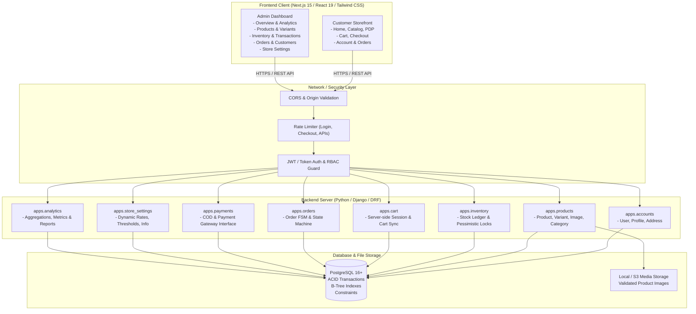
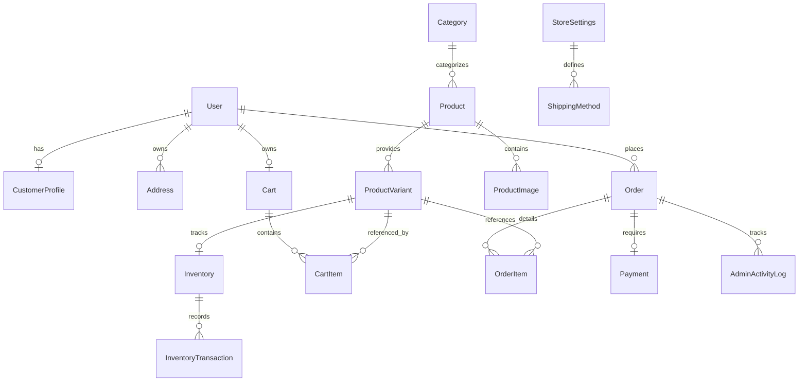

# ARCHITECTURE & SYSTEM DESIGN SPECIFICATION
## Project: Premium Full-Stack E-Commerce Web Application (Client Store)

---

## 1. Executive Summary & Requirements Analysis

### 1.1 Goal
Design and engineer an enterprise-grade, production-oriented full-stack e-commerce web application with a modern minimalist DTC (Direct-To-Consumer) aesthetic, rock-solid transactional reliability, robust security posture, and a comprehensive management back-office.

### 1.2 Core Business Pillars
1. **Customer Storefront**: Fast, accessible, mobile-first responsive storefront featuring announcement bars, hero banners, curated collections, product detail pages with variant selection (size/color), dynamic cart, multi-step checkout, order tracking, and customer account portals.
2. **Back-Office Admin Dashboard**: Real-time sales analytics, product management (CRUD, variants, images, categories), transactional inventory tracking with audit logging, order lifecycle management (status transitions, cancellation, refunding, internal notes), customer directory, and dynamic store configuration.
3. **Data Integrity & Concurrency**: Strict double-entry inventory ledger (`InventoryTransaction`), pessimistic locking (`select_for_update`) during checkout to eliminate race conditions and overselling, decimal monetary calculations, and server-side recalculation of every financial field.
4. **Security by Design**: Django password hashing (PBKDF2/Argon2), JWT / HttpOnly cookie authentication, strict role-based access control (RBAC), fine-grained object-level ownership checks, rate limiting on sensitive routes, MIME-type and magic-byte file validation, sanitized inputs, and hardened HTTP headers.

---

## 2. High-Level System Architecture



---

## 3. Technology Stack & Component Selection

| Layer | Technology | Justification & Guidelines |
|---|---|---|
| **Frontend Framework** | Next.js (App Router), React, TypeScript | SSR/SSG capabilities, fast page loads, typed contracts, modular layouts (`(store)` vs `admin`). |
| **Styling & Design** | Tailwind CSS, Lucide React Icons | Minimalist monochrome/neutral aesthetic, zero CSS runtime overhead, accessible components. |
| **Backend Framework** | Python 3.12+ / 3.14, Django 5+, Django REST Framework | Mature ecosystem, robust ORM with transactional integrity, built-in migration engine, enterprise security defaults. |
| **Database** | PostgreSQL 16+ | ACID compliance, row-level locking (`SELECT ... FOR UPDATE`), decimal support, robust indexing and JSONB where appropriate. |
| **Authentication** | JWT (SimpleJWT) / HttpOnly Cookie + Session fallback | Stateless scalability with client-side token rotation and CSRF protection. |
| **Containerization** | Docker, Docker Compose | Reproducible environment across dev, staging, and production. |

---

## 4. Normalized Database Schema Design

### 4.1 Schema Relationship Diagram



### 4.2 Core Tables & Specifications

1. **`accounts_user`**
   - `id`: UUID / BigAutoField (Primary Key)
   - `email`: VarChar(255), Unique, Indexed
   - `password`: VarChar(255), Django PBKDF2 hash
   - `first_name`, `last_name`: VarChar(150)
   - `role`: VarChar(20) [Enum: `CUSTOMER`, `STAFF`, `ADMIN`]
   - `is_active`: Boolean (Default True)
   - `is_staff`: Boolean (Default False)
   - `date_joined`, `last_login`: Timestamptz

2. **`accounts_address`**
   - `id`: BigAutoField
   - `user_id`: FK -> `accounts_user` (CASCADE)
   - `address_type`: VarChar(20) [Enum: `SHIPPING`, `BILLING`]
   - `full_name`, `phone_number`: VarChar(50)
   - `street_address_1`, `street_address_2`: VarChar(255)
   - `city`, `state_province`, `postal_code`, `country`: VarChar(100)
   - `is_default`: Boolean (Default False)

3. **`products_category`**
   - `id`: BigAutoField
   - `name`: VarChar(150), Unique
   - `slug`: SlugField(160), Unique, Indexed
   - `description`: TextField, Blank
   - `image`: ImageField / VarChar(255), Nullable
   - `is_active`: Boolean (Default True)
   - `created_at`, `updated_at`: Timestamptz

4. **`products_product`**
   - `id`: BigAutoField
   - `category_id`: FK -> `products_category` (PROTECT)
   - `title`: VarChar(255), Indexed
   - `slug`: SlugField(270), Unique, Indexed
   - `description`: TextField
   - `base_price`: Decimal(10, 2)
   - `sale_price`: Decimal(10, 2), Nullable (checked `< base_price`)
   - `is_active`: Boolean (Default True)
   - `is_featured`: Boolean (Default False)
   - `created_at`, `updated_at`: Timestamptz

5. **`products_productvariant`**
   - `id`: BigAutoField
   - `product_id`: FK -> `products_product` (CASCADE)
   - `sku`: VarChar(64), Unique, Indexed
   - `title`: VarChar(100) (e.g. "Matte Black / Large")
   - `color`: VarChar(50), Optional
   - `size`: VarChar(50), Optional
   - `additional_price`: Decimal(10, 2), Default 0.00
   - `created_at`, `updated_at`: Timestamptz

6. **`inventory_inventory`**
   - `id`: BigAutoField
   - `variant_id`: OneToOne -> `products_productvariant` (CASCADE)
   - `quantity`: Integer (Check `>= 0`)
   - `low_stock_threshold`: Integer (Default 5)
   - `is_in_stock`: Boolean (Auto-computed / Indexed)
   - `updated_at`: Timestamptz

7. **`inventory_inventorytransaction`** (Double-entry audit log)
   - `id`: BigAutoField
   - `inventory_id`: FK -> `inventory_inventory` (CASCADE)
   - `quantity_delta`: Integer (positive for restock/return, negative for sale)
   - `balance_after`: Integer
   - `reason`: VarChar(50) [Enum: `SALE`, `RESTOCK`, `RETURN`, `ADJUSTMENT`, `CANCELLATION`]
   - `reference_id`: VarChar(100), Optional (e.g. Order #)
   - `created_by`: FK -> `accounts_user`, Nullable
   - `created_at`: Timestamptz

8. **`cart_cart` & `cart_cartitem`**
   - Server-persisted session-aware carts linking to `User` (or UUID session key for guests).
   - Items link to `ProductVariant` with positive quantities.

9. **`orders_order`**
   - `id`: UUID (Primary Key) / Order Number (e.g. `ORD-2026-000123`)
   - `user_id`: FK -> `accounts_user` (SET_NULL, Nullable for guest checkout)
   - `status`: VarChar(30) [Enum: `PENDING`, `CONFIRMED`, `PROCESSING`, `SHIPPED`, `DELIVERED`, `CANCELLED`, `REFUNDED`]
   - `shipping_address`: JSONB snapshot (immutable record of address at checkout)
   - `subtotal_amount`, `shipping_amount`, `tax_amount`, `discount_amount`, `total_amount`: Decimal(10, 2)
   - `notes`: TextField (Customer order notes)
   - `admin_notes`: TextField (Internal store staff notes)
   - `tracking_number`: VarChar(100), Optional
   - `created_at`, `updated_at`: Timestamptz

10. **`orders_orderitem`**
    - `id`: BigAutoField
    - `order_id`: FK -> `orders_order` (CASCADE)
    - `variant_id`: FK -> `products_productvariant` (PROTECT)
    - `product_title`, `variant_title`, `sku`: VarChar snapshots
    - `unit_price`: Decimal(10, 2) (Price snapshot at purchase time)
    - `quantity`: Integer
    - `total_price`: Decimal(10, 2)

11. **`payments_payment`**
    - `id`: UUID (Primary Key)
    - `order_id`: OneToOne -> `orders_order` (CASCADE)
    - `payment_method`: VarChar(50) [Enum: `COD` (Cash on Delivery), `ONLINE_GATEWAY`]
    - `status`: VarChar(30) [Enum: `PENDING`, `PAID`, `FAILED`, `REFUNDED`]
    - `transaction_reference`: VarChar(255), Unique, Nullable
    - `amount`: Decimal(10, 2)
    - `paid_at`, `created_at`, `updated_at`: Timestamptz

12. **`store_settings_storesettings`**
    - Key-value or single-row model holding:
      - `store_name`, `support_email`, `phone`, `currency_symbol` (`$`)
      - `tax_rate_percent`: Decimal(5, 2)
      - `flat_shipping_rate`: Decimal(10, 2)
      - `free_shipping_threshold`: Decimal(10, 2)
      - `default_low_stock_threshold`: Integer

---

## 5. Backend REST API Architecture & Routes

### 5.1 Public / Customer Endpoints
- `POST /api/auth/register/` - Register customer account
- `POST /api/auth/login/` - Authenticate & retrieve JWT tokens
- `POST /api/auth/refresh/` - Refresh JWT access token
- `GET  /api/auth/me/` - Retrieve current customer profile
- `PUT  /api/auth/me/` - Update profile & contact information
- `GET, POST /api/addresses/` - List and create customer addresses
- `PUT, DELETE /api/addresses/{id}/` - Update / delete address
- `GET  /api/products/` - Catalog list (filtering by category, price, search, sorting, pagination)
- `GET  /api/products/{slug}/` - Detailed product info, variants, images, stock status
- `GET  /api/categories/` - Active categories with product count
- `GET  /api/cart/` - Retrieve cart & active items with stock status
- `POST /api/cart/items/` - Add or increment item
- `PATCH /api/cart/items/{id}/` - Update item quantity
- `DELETE /api/cart/items/{id}/` - Remove item from cart
- `POST /api/checkout/quote/` - Recalculate shipping, tax, discounts, and validate stock
- `POST /api/orders/` - Atomic checkout & order creation
- `GET  /api/orders/` - Customer order history
- `GET  /api/orders/{id}/` - Customer order details and status timeline
- `GET  /api/settings/public/` - Public store settings (shipping thresholds, currency, contact)

### 5.2 Protected Admin Endpoints (`IsAdminUser` required)
- `GET  /api/admin/analytics/overview/` - Revenue, order totals, count of pending/low-stock/customers
- `GET  /api/admin/analytics/sales-chart/` - Periodic sales breakdown (daily, weekly, monthly)
- `GET, POST /api/admin/products/` - List all products (active & inactive) / create product
- `GET, PUT, DELETE /api/admin/products/{id}/` - Product details, update, archive
- `POST /api/admin/products/{id}/images/` - Upload & reorder product images
- `POST /api/admin/products/{id}/variants/` - Add variant
- `GET  /api/admin/inventory/` - Inventory monitoring with stock levels & alerts
- `POST /api/admin/inventory/adjust/` - Record stock adjustment with transaction audit reason
- `GET  /api/admin/inventory/transactions/` - Audit history of inventory adjustments
- `GET  /api/admin/orders/` - Paginated orders with filter by status, search by customer/ID
- `GET, PATCH /api/admin/orders/{id}/` - Order details, status progression, internal notes
- `POST /api/admin/orders/{id}/cancel/` - Cancel order & return inventory
- `POST /api/admin/orders/{id}/refund/` - Mark refunded & reverse inventory if applicable
- `GET  /api/admin/customers/` - Customer list with order totals and spend metrics
- `PATCH /api/admin/customers/{id}/toggle-active/` - Disable or enable user account
- `GET, PUT /api/admin/settings/` - View & update store global configuration

---

## 6. Business Logic & Security Architecture

### 6.1 Concurrency & Overselling Prevention (Pessimistic Locking)
During checkout, orders are placed inside a database transaction:
```python
with transaction.atomic():
    # Lock matching variant inventory rows in deterministic order to prevent deadlocks
    inventories = (
        Inventory.objects.select_for_update()
        .filter(variant_id__in=variant_ids)
        .order_by("variant_id")
    )
    # Check quantities against requested items
    for item in items_to_purchase:
        inv = inventories_dict[item.variant_id]
        if inv.quantity < item.quantity:
            raise InsufficientStockError(f"Insufficient stock for {inv.variant.title}")
        inv.quantity -= item.quantity
        inv.save()
        # Create InventoryTransaction audit record
        InventoryTransaction.objects.create(
            inventory=inv,
            quantity_delta=-item.quantity,
            balance_after=inv.quantity,
            reason="SALE",
            reference_id=order.id
        )
```

### 6.2 Financial Integrity
- Prices submitted by the frontend are strictly treated as non-authoritative hints.
- The server recalculates:
  1. Base variant price: `variant.product.effective_price + variant.additional_price`
  2. Subtotal: $\sum (\text{unit\_price} \times \text{quantity})$
  3. Tax: $\text{subtotal} \times (\text{tax\_rate\_percent} / 100)$
  4. Shipping: Flat fee if $\text{subtotal} < \text{free\_shipping\_threshold}$, else $\$0.00$
  5. Total: $\text{subtotal} + \text{shipping} + \text{tax} - \text{discount}$
- Calculations are stored with Python `decimal.Decimal` and PostgreSQL `NUMERIC(10, 2)`.

### 6.3 Security Hardening Matrix
| Vulnerability Vector | Defense Mechanism |
|---|---|
| **SQL Injection** | Exclusively use parameterized Django ORM queries. |
| **XSS** | React DOM auto-escaping; Next.js sanitized inputs; DRF serializer escaping. |
| **CSRF** | SameSite cookie policy, JWT bearer headers for API clients. |
| **Brute Force** | Rate limiting on `/api/auth/login/` and `/api/checkout/` via Django throttling. |
| **Object Authorization** | Querysets filtered by `request.user` for customers; `IsAdminUser` permission class on admin viewsets. |
| **Malicious Uploads** | Pillow-based image format validation, MIME sniffing check, file size capped at 5MB, random UUID filenames. |
| **Price Tampering** | Server-side price recalculation at checkout quote & order creation. |

---

## 7. Frontend Architecture (Next.js 15 App Router)

### 7.1 Visual Design Strategy
- **Tone**: High-end minimalist Direct-To-Consumer (DTC) aesthetic (similar to Apple, Aesop, Toteme).
- **Palette**: Monochromatic (`#0A0A0A` black, `#FFFFFF` crisp white, `#F9FAFB` off-white, `#E5E7EB` soft borders, `#71717A` muted neutral typography).
- **Typography**: Clean modern sans-serif (`Inter` or `Geist`) with balanced tracking and editorial layout.
- **States**: Explicit Skeleton loaders for data fetching, empty states with clear calls-to-action, contextual validation errors.

### 7.2 Directory & Component Layout
```
frontend/
├── src/
│   ├── app/
│   │   ├── (store)/                 # Customer Storefront Route Group
│   │   │   ├── page.tsx             # Hero banner, featured collections, bestsellers, newsletter
│   │   │   ├── products/
│   │   │   │   ├── page.tsx         # Catalog grid with filters & sorting
│   │   │   │   └── [slug]/page.tsx  # Product details, image gallery, variant selector, related items
│   │   │   ├── cart/page.tsx        # Shopping cart review & quantity editor
│   │   │   ├── checkout/page.tsx    # Multi-step checkout (address, shipping, payment, order summary)
│   │   │   ├── account/
│   │   │   │   ├── login/page.tsx   # Customer login
│   │   │   │   ├── register/page.tsx # Customer registration
│   │   │   │   ├── profile/page.tsx # Profile & address book
│   │   │   │   └── orders/          # Order history & live status tracker
│   │   │   └── layout.tsx           # Storefront layout (Announcement bar, Header, Footer)
│   │   ├── admin/                   # Back-office Admin Route Group (Protected)
│   │   │   ├── login/page.tsx       # Staff/Admin secure login
│   │   │   ├── dashboard/page.tsx   # Revenue, orders, quick stats, sales chart
│   │   │   ├── products/            # Product CRUD, variant editor, image upload
│   │   │   ├── inventory/           # Stock levels, low-stock alerts, adjustment ledger
│   │   │   ├── orders/              # Order list, status transitions, internal notes
│   │   │   ├── customers/           # Customer directory & lifetime spend
│   │   │   ├── settings/            # Dynamic store configuration
│   │   │   └── layout.tsx           # Admin layout (Sidebar, Header, Staff RBAC guard)
│   ├── components/
│   │   ├── storefront/              # Hero, ProductCard, VariantSelector, CartDrawer, etc.
│   │   ├── admin/                   # MetricCards, OrderTable, InventoryModal, Charts
│   │   └── ui/                      # Button, Input, Modal, Badge, Dropdown, Table, Skeleton
│   ├── context/                     # CartContext, AuthContext, ToastContext
│   ├── services/                    # api.ts, productService, cartService, orderService, adminService
│   └── types/                       # TypeScript interfaces for API contracts
```

---

## 8. Multi-Phase Implementation Roadmap

- **Phase 1**: Requirements Analysis & System Architecture Specification *(Current)*
- **Phase 2**: Database Schema, Django Project & Apps Setup, Database Migrations
- **Phase 3**: Authentication, RBAC, Customer Accounts & Address Management
- **Phase 4**: Product Catalog, Variants, Categories & Inventory APIs
- **Phase 5**: Cart, Checkout, Atomic Order Creation & Payment Interface
- **Phase 6**: Next.js Storefront (Design, Hero Banner, PDP, Cart & Checkout UI)
- **Phase 7**: Admin Dashboard (Analytics, Inventory Ledger, Order & Product Management)
- **Phase 8**: Full End-to-End Frontend-Backend Integration
- **Phase 9**: Comprehensive Test Suite (Unit, Integration, Concurrency) & Security Audit
- **Phase 10**: Dockerization, Docker Compose, Production Deployment Config & Documentation
